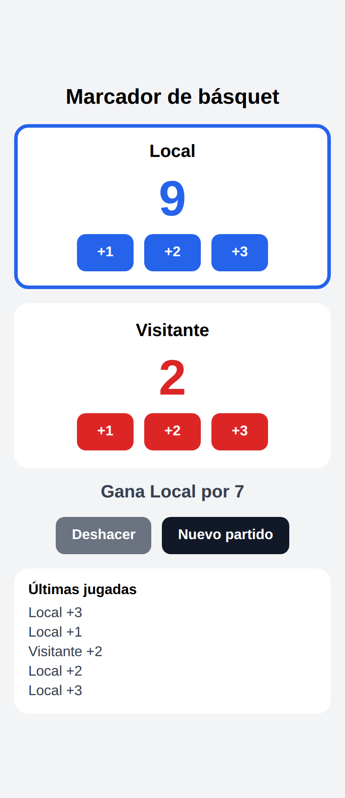
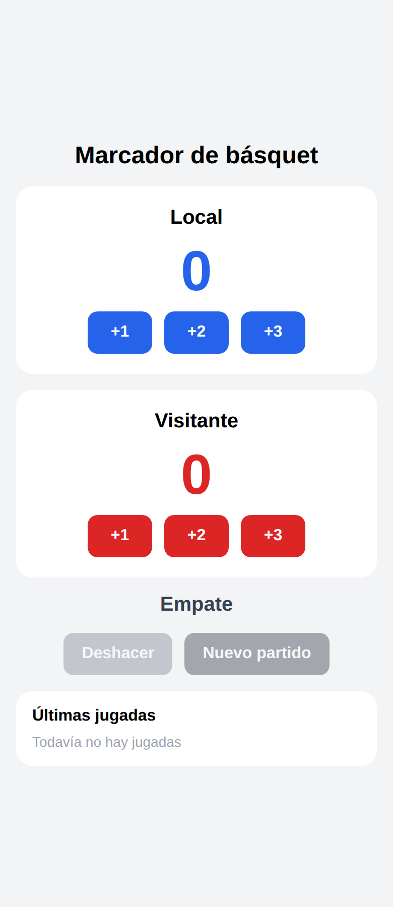

# Marcador de básquet 🏀

Entregable de la **Clase 8** — Desarrollo de Aplicaciones para Dispositivos Móviles.

Marcador para dos equipos (Local y Visitante) hecho con **Expo + React Native + TypeScript**. Cada jugada suma 1, 2 o 3 puntos, muestra quién va ganando, guarda las últimas jugadas y permite deshacer.

| Un equipo ganando | Marcador 0 a 0 (Nuevo partido deshabilitado) |
|---|---|
|  |  |

## Cómo correrla

```bash
npm install
npx expo start        # escanear el QR con Expo Go
npx expo start --web  # o verla en el navegador
```

## Estructura

```
App.tsx                      → monta la pantalla
screens/MarcadorScreen.tsx   → pantalla: estado, anotar(), deshacer() y estado derivado
components/PanelEquipo.tsx   → nombre, puntaje y botones de un equipo (sin estado)
components/BotonAccion.tsx   → botón reutilizable de la clase (+ prop disabled)
```

## Ejercicios (un commit por ejercicio)

1. **Marcador con una sola función.** Un `useState` por equipo y una única `anotar(equipo, puntos)` para los seis botones. `equipo` está tipado como `type Equipo = 'local' | 'visitante'`, así que `anotar('locall', 2)` no compila. `anotar` usa el setter funcional (`prev => prev + puntos`) y `nuevoPartido` el valor directo (`0`).
2. **Componente `<PanelEquipo />`.** Recibe `nombre`, `puntos`, `color` y `onAnotar: (puntos: number) => void`. No tiene `useState`: el puntaje vive en la pantalla. Se usa dos veces con colores distintos, y sus botones son `<BotonAccion />`.
3. **Estado derivado.** La leyenda ("Gana Local por 5" / "Empate"), el resaltado del panel ganador (prop `ganando`) y el botón *Nuevo partido* deshabilitado en 0 a 0 (prop `disabled` en `BotonAccion`) se calculan en cada redibujado a partir de `local` y `visitante`. No hay ningún `useState` nuevo.
4. **(Opcional) Últimas jugadas y Deshacer.** Cada jugada se guarda como objeto `{ equipo, puntos }` en `jugadas: Jugada[]`. Se muestran las 5 últimas (la más reciente arriba). *Deshacer* resta los puntos de la última jugada con la misma función `sumar` que usa `anotar` y la saca con `jugadas.slice(0, -1)`. Se deshabilita cuando no hay jugadas, y *Nuevo partido* también vacía la lista.

## Respuestas del Ejercicio 2

**¿Por qué acá el estado tiene que vivir en el padre?**
En el ejercicio de los tres contadores cada contador era independiente: nadie de afuera necesitaba saber su valor. Acá la pantalla necesita comparar los dos puntajes para saber quién gana, mostrar la leyenda, resaltar el panel ganador y habilitar o no *Nuevo partido* (Ejercicio 3). Si cada `PanelEquipo` guardara su propio puntaje, el padre no podría leerlos ni ponerlos en 0. Por eso el estado sube al ancestro común y baja a cada panel por props.

**Adentro de `PanelEquipo`, ¿cómo le pasás el `onAnotar` a cada botón? ¿Por qué no alcanza con `onPress={onAnotar}`?**
A cada botón le paso una función flecha que llama a `onAnotar` con su cantidad: `onPress={() => onAnotar(2)}`. No alcanza con `onPress={onAnotar}` porque `onPress` espera una función `() => void` y la llama sin el número que necesitamos: `onAnotar` recibiría el evento del toque (o nada) en lugar de 1, 2 o 3. Además, los tres botones harían exactamente lo mismo. La flecha "fija" cuántos puntos vale cada botón.
